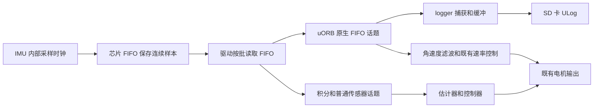

# CUAV X7+ 飞控振动数据采集方案

版本 1.0，2026-10-12。主要对象是普通 CUAV X7+，软件基点固定为官方 PX4 v1.16.1。H1 复用日志功能和分析方法，按它实际搭载的 IMU 单独核实采样率与带宽。

第一阶段使用飞控内部 IMU 和 SD 卡，保存传感器原生 FIFO 数据，在电脑上分析飞控实际承受的振动。主分析频段为 **1–500 Hz**，重点观察 **20–400 Hz**；**500–1000 Hz** 作为探索频段。保存现有驱动已经产生的高频样本，不为采集提高 IMU 采样率、改变滤波或提高控制频率。先采一颗已确认的 ICM20689 的加速度和陀螺，资源验收后再增加其它 IMU。

## 研究目标和测量位置

采集需要回答三个问题：飞控 IMU 所在位置有哪些主要振动频率，振动强度如何随转速与飞行工况变化，以及不同减震台方案是否降低了这些频段的振动，同时引入了新的低频共振。

加速度三轴是减震台研究的主要观测量，陀螺三轴用于辨别旋转振动及其与控制响应的关系。保留正常飞行日志，便于同步查看电机输出、姿态、估计器状态、转速和飞行阶段。实际配置保留 SDLOG_PROFILE 的 bit 0 Default，再叠加 bit 8/9；这三位合计为 769，其它原有 profile 位是否保留按配置快照决定，不能直接覆盖丢弃。只开 768 的 raw 位会缺少默认飞行分析话题，主机集成测试的 768 配置不直接用于实机。没有转速数据时，不能只凭频率峰把原因唯一归为电机、桨或结构模态。

X7+ 有内部减震结构。内部 IMU 测到的是外部减震台、飞控壳体、内部安装结构和传感器响应共同作用后的结果。这种测量直接对应飞控感受到的振动，适合比较减震台方案；它不能独立给出机架输入到平台输出的传递函数。三个内部 IMU 也不能直接当作减震台的输入与输出测点。

如果后续需要定量识别平台固有频率、阻尼和传递率，应增加机架侧与平台侧同步参考测量。单测点峰值下降可以作为工况匹配后的效果证据，但不能单凭它确定弹簧刚度、证明传递率或证明高频输入不存在。

## 分析频段和选择依据

| 频段 | 第一阶段用途 | 判读条件 |
|---|---|---|
| 1–20 Hz | 观察平台低频共振、机体运动和控制耦合 | 区分姿态改变、重力投影和真实振动，不能全部归为机械故障 |
| 20–400 Hz | 主要研究电机与桨激励、结构共振及谐波 | 同步比较 RPM、工况和三轴响应 |
| 400–500 Hz | 保留主频段上方余量 | 核实硬件滤波对幅值的影响 |
| 500–1000 Hz | 搜索更高阶成分，形成后续测量线索 | 需要传感器通带及安装响应证据，第一阶段不作为平台设计的唯一依据 |
| 高于 1000 Hz | 保存数据中的可见线索 | 原生 ODR 与奈奎斯特上限不等于可信测振带宽；需要时使用外部测振设备 |

已有八篇文献调研覆盖了几十赫兹到几百赫兹的飞行振动。例如 CDC 2014 的飞行测量采用 1 kHz 采样，报告了 391.3 Hz 的谱峰；INSCIT 2024 按 0–500 Hz 设计测量带宽。这支持优先研究 1–500 Hz，**不能把 400–500 Hz 当作无人机振动的物理上限**。论文的采样和分析范围本身限制了可观察频率。结构解析中的 kHz 模态也不能直接当作本机飞行中已经出现的振动。

旋转频率为 RPM/60，桨叶通过频率为 RPM×桨叶数/60。二者必须区分。峰值随 RPM 移动是转速相关激励的线索，固定峰是结构模态的线索；谐波重叠、松动和工况变化仍需其它证据。文献整理见本地 [振动频率文献综述](E:/04-Workspace_workbudy/00_飞控/06_振动文献调研/振动频率文献综述.md)，关键采样与频率值还应与其中逐页提取文本相互核对。

## 采集硬件和采样率

普通 X7+ 的官方硬件配置为 STM32H743、两颗 ICM20689 和一颗 ICM42688P，并有内部减震。本文中的普通 X7+ 与 X7+ Pro 分开识别。[CUAV X7+ 官方硬件资料](https://doc.cuav.net/en/controller/x7-plus/x7-plus.html)

| 硬件或通道 | 本版驱动的原生配置 | 第一阶段用途 |
|---|---|---|
| ICM20689 加速度 | 4 kHz，名义 dt=250 µs | 首选三轴线振动记录 |
| ICM20689 陀螺 | 8 kHz，名义 dt=125 µs | 同颗 IMU 的旋转振动对照 |
| ICM42688P 加速度和陀螺 | 驱动配置 ODR 为 8 kHz | 资源通过后增加对照；芯片时间基准需按实际 dt 核验 |
| SD 卡 | 实测持续写入和最长停顿 | 原生 ULog 保存，正常飞行日志同时保留 |
| H1 的 IMU | 按实机芯片和原分支驱动核实 | 不把 X7+ 的 4/8 kHz 直接套到 BMI088 等通道 |

上表是固定源码配置，实际启用芯片、FIFO 话题实例及有效日志采样率仍需上板核对。X7 构建目标为 cuav_x7pro_default；目标名中的 pro 不代替产品型号识别。板级启动脚本支持探测不同传感器，且加速度和陀螺的 FIFO 实例分别分配，因此不能按“实例 0”或启动顺序猜测芯片。先用 device_id 分别建立通道映射，并确认正常控制选择的 IMU 是否也在记录范围内。

4 kHz 与 8 kHz 的理论奈奎斯特上限分别为 2 kHz 与 4 kHz，为 500 Hz 主分析频段留出了采样余量。但是，传感器模拟响应、硬件抗混叠滤波、安装结构和数据连续性共同决定可用带宽。尤其 ICM42688P 驱动配置了名为 **585 Hz** 的硬件抗混叠参数档；8 kHz ODR 不表示 0–4 kHz 幅值都准确。第一阶段保留这些硬件滤波，跨芯片比较幅值时考虑响应差异。

因此，本方案的“采样多高”是 **尽量完整保存现有 4/8 kHz 原生样本**；“可信分析多高”先以 **1–500 Hz** 为主，探索段须另核实测量链路。ICM42688P 在 500 Hz 以上更适合搜索线索，不能直接据此跨芯片比较振动幅值。这是两项不同的指标。

## PX4 程序流转与采样频率的关系

PX4 没有一个决定所有模块频率的统一主循环。传感器中断、工作队列、估计器、控制器和 logger 有各自的触发与调度方式。

| 频率 | 决定因素 | 与振动采集的关系 |
|---|---|---|
| IMU 原生样本频率 Fs | 芯片时钟和驱动写入的 ODR 配置 | 决定芯片产生样本的速度 |
| FIFO 读取与消息发布频率 Fp | 批量大小、FIFO 水位、驱动调度和最大报告率等 | 一个消息可包含多个样本，Fp 可以远低于 Fs |
| 估计器和控制频率 | 积分、滤波、调度及既有控制配置 | 不要求原生 FIFO 日志降低到控制频率 |
| logger 捕获频率 | logger 定时器、订阅和 CPU 调度 | 决定检查并复制消息的及时程度，不是逐样本硬件时钟 |
| SD 写入节奏 | 写线程、缓冲、文件系统和卡的停顿 | 可以批量写入，但长期平均吞吐与缓冲余量必须够用 |

例如，一条 8 kHz 陀螺流每包含 20 个连续样本，则约 400 包/s 就能承载 8,000 样本/s。不是每个样本都需要整个 PX4 程序运行一遍。已有 raw FIFO profile 把 logger 捕获间隔设为 800 µs，约 1,250 次/s；这个数也不是日志中的原生样本率。只要各级保留完整批次，400 Hz 消息发布和不同频率的控制器可以与 8 kHz 原生日志并存。

**程序流转会影响最终保留下来的数据。** 驱动来不及排空芯片 FIFO 会产生溢出或复位；订阅者来不及读取会遇到 uORB 队列覆盖；日志缓冲不足或 SD 卡长时间停顿会丢日志。此时硬件可能仍按原 ODR 工作，但记录已经有缺口。sensor_accel_fifo 的消息队列为 1，sensor_gyro_fifo 为 4；两者对延迟的容忍度不同。

从 sensor_combined、滤波或积分后的话题取数据时，采样与发布路径中的降采样确实会限制可观察频率。已有约 200 Hz 日志最多只能支持低于 100 Hz 的理论无混叠分析，不能用软件插值恢复其中没有记录的高频振动。这也是本方案选择原生 FIFO 话题的原因。

## 编程方案和代码边界

基点为官方 v1.16.1 提交 94cb2012792b2ae89f0b147cfee53ee31ae550be，分支为 feature/cuav-x7-vibration-logging。功能从官方版本建立，未以 H1 适配分支为父提交。组织与个人仓库分别为 NexusAir-Technologies/PX4-H1 和 Whale-Talk/PX4-Autopilot-mjy。

生产代码在 logger 层增加 SDLOG_ACC_MASK 和 SDLOG_GYR_MASK，默认均为 1，bit n 选择该类型 FIFO 话题的实例 n。只有 SDLOG_PROFILE 对应 raw FIFO 位开启时 mask 才生效；订阅间隔为 0，不额外限速。mask=0 不选择该类型，但不能关闭已经开启的快速 profile。第一版在启动 logger 时读取参数，不在飞行中动态重配。

非法 mask 在该次启动回退到 1，超过构建支持实例数的高位被裁掉，不改写持久参数。外部 logger_topics.txt 仍整体替换 profile 清单，此路径不应用 mask；不能在保留该文件时假设 mask 已控制采集。保持原有订阅容量、去重与失败处理，并在 raw profile 路径记录约 1 Hz 的两个 logger_status 实例，用消息 type 区分 full 与 mission。

IMU 驱动、ODR、硬件滤波、积分、IMU_GYRO_RATEMAX、控制参数、传感器选择、采样消息结构、写线程优先级和默认 LOGGER_BUF 均不因这次补丁改变。原有 raw profile 提高 logger 优先级和捕获频率的行为仍然存在；增加通道会加重该既有模式的负载。

配置检查、ULog 解码和谱分析放在电脑端。实现与操作细节分别见 [实施计划](implementation-plan.md)、[采集操作指南](operation-guide.md) 和 [离线工具说明](../../Tools/vibration/README.md)。原生 FIFO 日志功能的基础说明见 [PX4 v1.16 日志文档](https://docs.px4.io/v1.16/en/dev_log/logging)。

## 数据展开和频谱分析

每包只取 samples 个有效值，不能把长度 32 数组中的填充区当成样本。加速度为 raw×scale，单位 m/s²；陀螺为 raw×scale，单位 rad/s。scale 逐包应用，不能全程固定为第一包的值。数据已应用驱动旋转，但没有完整的偏置、温度等控制侧校准。

timestamp_sample 是该批最后样本的名义时间锚点。按 dt 的微秒单位展开时，索引 i 的名义时间为 T−(N−1−i)×dt。ICM42688P 的 dt 来自该批最后芯片时间增量，存在量化与批内变化；ICM20689 的加速度与陀螺也可能有相位差，不能宣称它们逐样本严格同步。

先检查 device_id 变化、dt/scale、样本数、时间单调性、发布延迟与跨包残差，再按连续设备段分析。跨包残差 T[k]−T[k−1]−N[k]×dt[k] 是一致性指标，不是精确丢样计数。有效端点速率使用从第二包起的样本总数除以首末锚点时间差；不能把第一包也加进去。设备切换或明显缺口两侧不直接拼接做 FFT。

离线分析使用三轴时域波形、分频段 RMS、PSD 和时频谱。初始 Welch 窗长可取 4–8 s、Hann 窗、50% 重叠，名义频率分辨率约 0.25–0.125 Hz；结合工况稳定时间再调整。去除窗口均值，低频结果结合姿态与重力投影解释。存在不规则时序时先评估重采样方法，不跨明显缺口强行插值，也不为画图把高采样数据未经抗混叠处理直接抽点。

比较减震台方案时保持机体、载荷、转速区间、安装方式、传感器、滤波和分析方法一致。保存总 RMS 与分频段 RMS，特别检查峰值下降是否伴随新的低频峰。只有同工况、同测量链路的比较才能支持效果判断。

## CPU 内存和 SD 带宽验收

uORB 订阅者各自维护读取状态，增加 logger 订阅不会消耗控制订阅者的数据。但它们共享 CPU 和有限队列；logger 复制、编码、锁占用及写卡负载增加后，仍可能推迟驱动或控制任务。因此“没有改控制代码”与“飞行性能不会受影响”不能画等号。

一条原生 FIFO ULog 数据记录约 226 B，即使有效 samples 较少，固定数组仍占记录空间。若陀螺与加速度**各**发布 800 包/s，总计 1,600 包/s，约 0.3616 MB/s；仅这两路 10 分钟约 217 MB。若两路**合计** 800 包/s，则约 0.1808 MB/s、10 分钟约 108 MB。还需加上正常飞行话题与元数据，以实际日志码率核实。

8 KiB 缓冲只覆盖上述 0.3616 MB/s 流量约 22.7 ms 的积压。这是预算示例，不能证明 SD 卡足够，也不能据此直接分配更多 RAM。普通 NuttX 启动脚本保持 LOGGER_BUF 默认 8 KiB；手动 logger start 未指定 -b 时，模块内部默认是 12 KiB，两种入口不能混为一谈。实验若需调整，只在保存并合并 config.txt 后显式配置，并核验实际 buffer_size_bytes、连续可用堆、任务栈与分配结果。

| 对照档 | 固件与记录设置 | 目的 |
|---|---|---|
| A | 官方基线固件，原正常日志 | 得到原资源和飞行状态 |
| B | 官方基线固件，开启原有单实例 raw FIFO | 测量进入高频日志模式本身的代价；无新增 mask 参数 |
| C | 新固件，raw FIFO 的同一实例、同一 device_id 和通道数 | 隔离本次代码变化的代价 |
| D | 新固件，逐次增加已映射实例 | 测量增加通道的代价，决定实机最大允许配置 |

每档先做至少覆盖预计飞行日志时长的地面录制，保存 CPU/任务负载、堆与栈、控制周期和输出时序、驱动 FIFO 溢出/复位、日志总码率、SD write/fsync 停顿和日志健康计数。logger status 查询可能清零部分计数，应保存每次结果及时间，同时检查持续 logger_status 和 ULog dropout 标记。1 Hz 的 logger_status 不提供逐包精确故障时刻。

验收检查完整选中通道、时间与数值合理性、无新增无法解释的丢失或控制退化，以及动态资源余量。出现异常时先减少记录通道并复核，不能通过提高控制频率或随意修改滤波来掩盖采集问题。CPU 的一个平均百分比不足以证明截止时间和长尾延迟满足要求；门槛依据实机基线与飞行要求确定。地面通过后按原飞行试验流程进行短时同工况对照。

## 软件验证状态和实机步骤

官方基线、C1 修改版和最终 C2 cuav_x7pro_default 均构建通过。最终固件源码身份为 9b103208，FLASH 为 1,915,488/1,966,080 B，比基线增加 728 B，剩余 50,592 B；静态 AXI_SRAM 44,712 B 未变。新增主机测试没有进入硬件固件。静态资源不能代表运行堆、任务栈或 SD 性能。[最终构建与产物身份](c2-build.json)；前一阶段身份另见 [C1 记录](c1-build.json)。

订阅功能测试普通配置 16 项通过、1 项因实例上限不适用而跳过，实际受限构建 17/17 通过。离线工具在现有 pyulog 环境 63 项中 61 项通过，2 项为缺依赖环境的互斥分支。真实 uORB 到 logger 集成日志验证了选中与未选中实例、逐包全部样本值及 logger_status；该人工发布测试不代表 X7 的 4/8 kHz 长时连续采集或实机调度。详细结果见 [C1 验收](c1-review.md) 和 [C2 验收](c2-review.md)。

通用 px4_fmu-v6x_default 构建通过，但原 H1 定制目标尚未移植并验证这份补丁。当前还未进行 X7+ 实机 CPU、SD 和飞行对照，不能把软件验证当作飞行验收。

下一步依次完成：核对实机固件与 IMU 映射；保存基线固件、参数和配置；运行 A/B/C 的单颗地面资源与连续性对照；逐次增加通道完成 D 档；通过后做短时飞行对照；最后按工况输出频谱、峰值与分频段 RMS，用于减震台方案比较。

退出实验时恢复原 SDLOG_PROFILE、mask、SDLOG_MODE 和缓冲配置，并重启；只把 mask 设为 0 不能恢复普通 logger 模式。必要时使用已经归档并核验身份的基线固件。每个软件阶段单独提交并同步两个仓库，实机参数和测试记录与对应固件 SHA 一起保存。

## 固定源码证据

以下配置依据均为固定 v1.16.1 源码，避免将另一版默认值混入本方案。

- [ICM20689 原生 8 kHz 陀螺与 4 kHz 加速度配置](https://github.com/PX4/PX4-Autopilot/blob/94cb2012792b2ae89f0b147cfee53ee31ae550be/src/drivers/imu/invensense/icm20689/ICM20689.hpp)
- [ICM42688P 的 8 kHz ODR 和硬件滤波配置](https://github.com/PX4/PX4-Autopilot/blob/94cb2012792b2ae89f0b147cfee53ee31ae550be/src/drivers/imu/invensense/icm42688p/ICM42688P.hpp)
- [X7 板级传感器探测与启动](https://github.com/PX4/PX4-Autopilot/blob/94cb2012792b2ae89f0b147cfee53ee31ae550be/boards/cuav/x7pro/init/rc.board_sensors)
- [FIFO 加速度消息](https://github.com/PX4/PX4-Autopilot/blob/94cb2012792b2ae89f0b147cfee53ee31ae550be/msg/SensorAccelFifo.msg) 和 [FIFO 陀螺消息](https://github.com/PX4/PX4-Autopilot/blob/94cb2012792b2ae89f0b147cfee53ee31ae550be/msg/SensorGyroFifo.msg)
- [logger 订阅、捕获循环和健康发布](https://github.com/PX4/PX4-Autopilot/blob/94cb2012792b2ae89f0b147cfee53ee31ae550be/src/modules/logger/logger.cpp)
